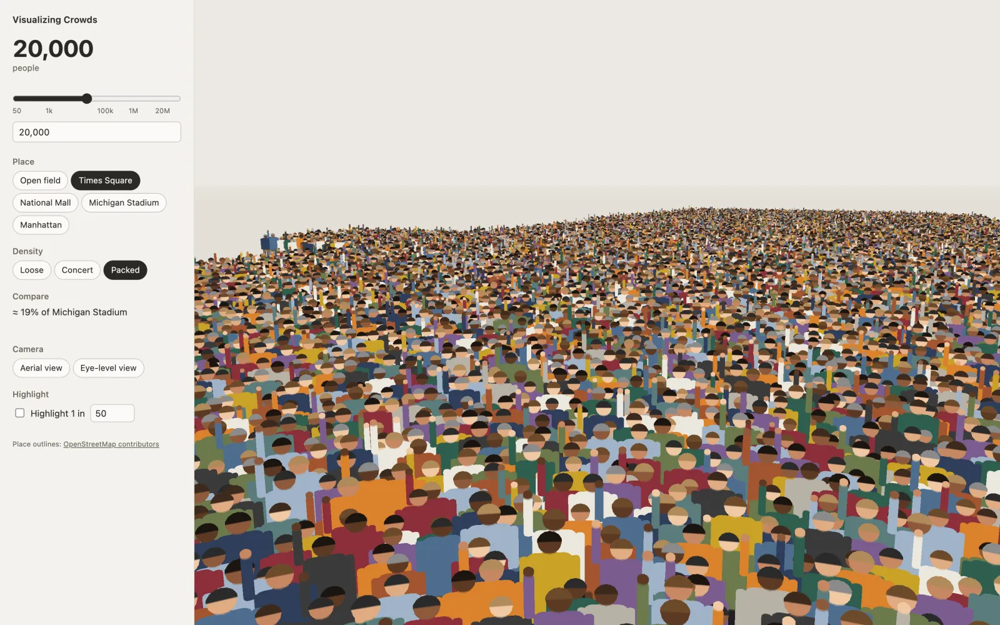
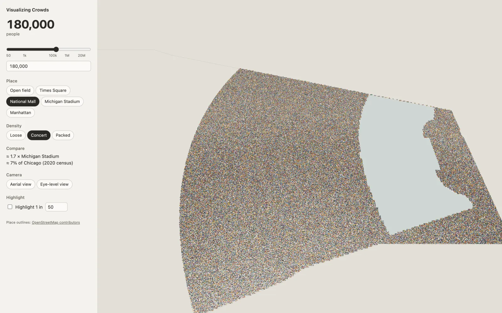
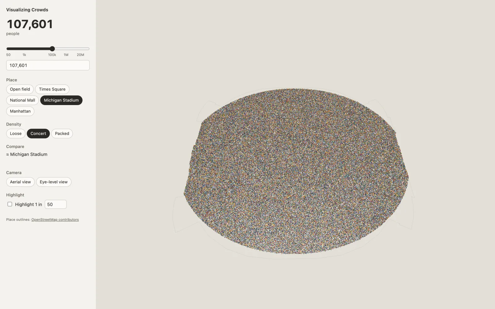
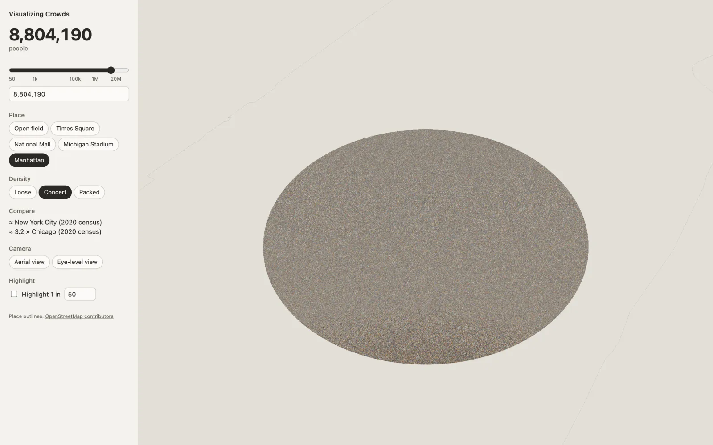
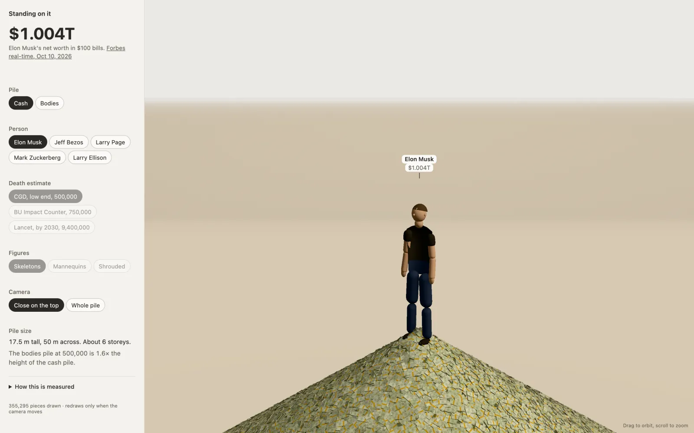
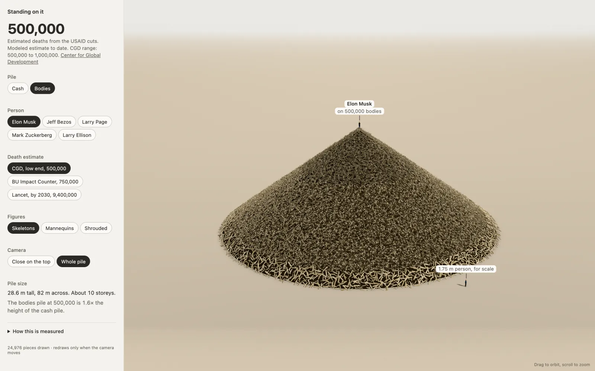

# Visualizing Crowds

A browser tool that shows what a number of people looks like, from 50 to 50 million, standing in a real place. Drag the count, pick a place and a density, and the crowd fills the place outward from a focus point.



Live: [visualizing-crowds.vercel.app](https://visualizing-crowds.vercel.app)

## What it does

- **Count** from 50 to 50,000,000 on a log slider, or type an exact number.
- **Five places** with real outlines from OpenStreetMap: an open field, Times Square, the National Mall, Michigan Stadium and Manhattan. Water and buildings are cut out as holes.
- **Three densities** in people per square metre: Loose (1), Concert (2.5) and Packed (4.5). When the count exceeds what the place holds, the sidebar says so and gives the capacity.
- **Compare** lines put the count next to a known venue or city ("≈ 1.7 × Michigan Stadium", "≈ 7% of Chicago").
- **Camera** presets for an aerial view and an eye-level view, with orbit and zoom in between.
- **Highlight 1 in N** turns the crowd neutral grey and marks about one person in N in red, so a ratio becomes visible.
- **Shareable URLs.** Place, count, density and highlight live in the query string, for example [`?place=manhattan&count=8804190&density=2.5`](https://visualizing-crowds.vercel.app/?place=manhattan&count=8804190&density=2.5).

## Screenshots



180,000 people on the National Mall, the default view. The water stays empty.



Michigan Stadium at its official capacity of 107,601.



The population of New York City (2020 census) standing in Manhattan. At this scale the crowd is drawn by the far ground shader.

## How it renders

Everything derives from one number: the crowd's fill radius from the place's focus point, computed for the current place, density and count. Three levels of detail read that same radius, so the crowd edge lines up across them.

| Tier | Drawn as |
|---|---|
| Near | Instanced billboard people (hair, arms, two legs, ground shadow), built per 50 m tile around the camera target |
| Mid | One shirt-colored dot per person, out to where a person is under about 2 px tall |
| Far | A ground shader that colors each person's cell from the place mask texture and the fill radius |

Each person's clothing and skin colors come from a hash of their grid cell. The same hash runs in TypeScript and in GLSL, so a person keeps their colors when they move from one tier to the next. `hash-test.html` checks the two implementations against each other.

The near tier starts with a budget of 400,000 sprites and lowers it in steps while the frame rate stays under 50 fps. Add `?debug` to the URL to see fps, sprite and dot counts.

## Standing on it (`wealth/`)

A separate app in the same repo, sharing the stack and visual tone. A labeled figure stands on a to-scale heap that switches between **Cash** (a billionaire's net worth in $100 bills) and **Bodies** (estimated deaths from the USAID cuts, using one of three published estimates). Both heaps are cones at a 35° angle of repose sized from real volumes, with a 1.75 m person at the base for scale. Every figure shows its source, link and date, and a "How this is measured" note explains the math.





Run it locally with the commands below.

## Tech stack

- TypeScript, Vite 5
- Three.js 0.170, plain and imperative, for the scene
- React 18 for the sidebar only
- Vitest for unit tests, Playwright for end-to-end tests in Chromium and WebKit
- Vercel for deployment

## Getting started

Crowd visualizer, on http://localhost:5173:

```bash
npm install
npm run dev
```

Standing on it, on http://localhost:5174:

```bash
npm --prefix wealth install
npm --prefix wealth run dev
```

Other scripts (run from the repo root, or with `--prefix wealth` for the wealth app):

| Script | What it does |
|---|---|
| `npm run build` | Type-check, then build to `dist/` |
| `npm test` | Unit tests (Vitest) |
| `npm run e2e` | Builds, serves on port 4173 and runs the Playwright suite |
| `npm run places` | Re-extracts place outlines from OpenStreetMap (Nominatim) into `src/places/data/` |
| `npm run places:preview` | Renders the extracted outlines to SVGs in `docs/place-previews/` for a visual check |

## Project layout

```text
src/
  places/    place JSON, loader and validation
  layout/    fill-radius math and cell occupancy (pure functions)
  crowd/     per-person attributes from a cell hash
  render/    Three.js scene, camera, LOD tiers, shaders, sprite atlas
  ui/        React sidebar, count control, venue comparisons
scripts/     OpenStreetMap extraction and outline previews
e2e/         Playwright specs
wealth/      Standing on it, a separate Vite app
docs/        design specs, plans and screenshots
```

Design specs live in [`docs/superpowers/specs/`](docs/superpowers/specs/). Place outlines © [OpenStreetMap contributors](https://www.openstreetmap.org/copyright).
